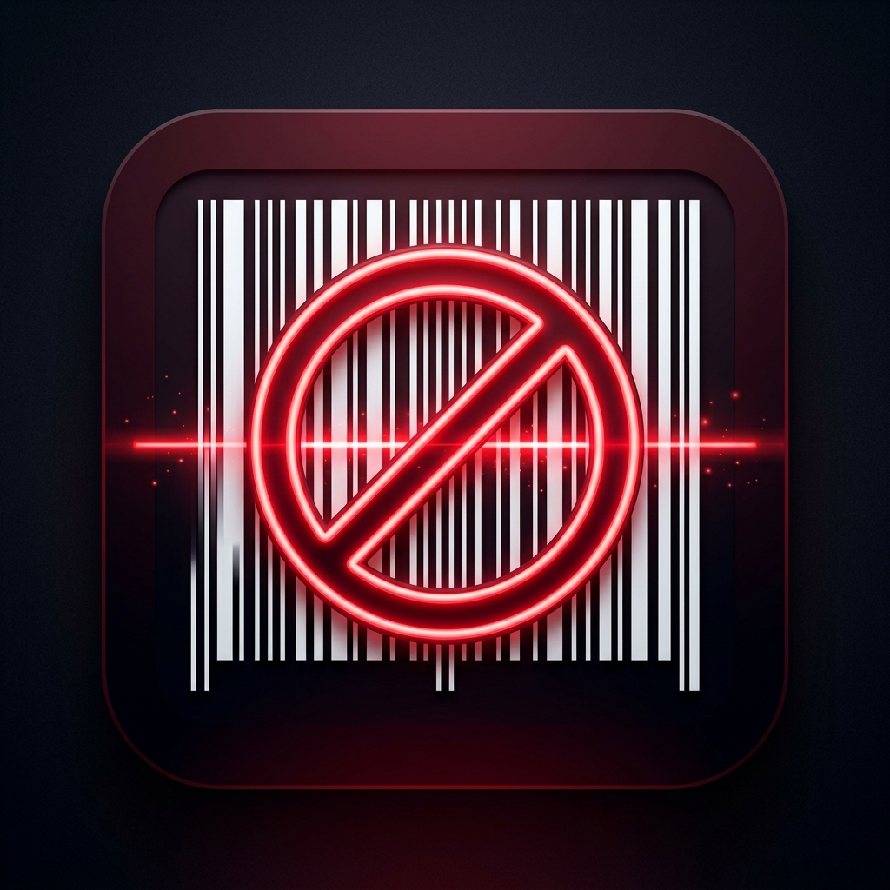

# 🛑 Boykot Barkodu

<p align="center">
  
</p>

<p align="center">
  <strong>Bilinçli tüketim için barkodunu tara, boykotu anında öğren!</strong><br>
  Market raflarında ürünlerin isimlerini tek tek aramaya son; saniyeler içinde barkod okuma, gerekçe analizi ve yerli alternatif önerileri.
</p>

<p align="center">
  
  
  
  
</p>

---

## 📌 Neden Boykot Barkodu?

Günlük alışverişlerimizde bir ürünün boykot kapsamında olup olmadığını anlamak için web sitelerinde tek tek marka aramak zaman alır ve zahmetlidir. **Boykot Barkodu**, sadece telefon kameranızı ürünün barkoduna tutarak:

1. Ürünün ve çatı şirketin **boykot durumunu** tespit eder.
2. Boykot listesindeyse **nedenini ve kanıt bağlantılarını** gösterir.
3. Aynı rafta bulabileceğiniz **temiz ve yerli alternatifleri** anında listeler.

---

## ✨ Öne Çıkan Özellikler

* **⚡ Ultra Hızlı Barkod Tarama:** EAN-13, EAN-8, UPC-A ve UPC-E barkodlarını kamera ile anında yakalar.
* **🔍 Güvenilir Çift Kaynak Entegrasyonu:**
  * **Boykot Dedektifi** (`boykotdedektifi.com`) ve **Boykot.co** güncel veritabanları ile canlı sorgulama.
  * En sık tüketilen yüzlerce ürün için **çevrimdışı (offline) yerel veritabanı** (internetsiz de anında yanıt).
  * 729 ile başlayan barkodlar için otomatik menşei (İsrail GS1) koruması.
* **🛡️ Yerli & Temiz Alternatif Önerileri:** Boykotlu bir ürün algılandığında yerli üretici, kooperatif veya temiz alternatif markalar kartlar halinde sunulur.
* **🤖 "AI'a Sor" Boykot Asistanı:**
  * Sadece boykot konularına odaklanmış, uydurma/halüsinasyon üretmeyen **doğrulanmış sohbet motoru**.
  * *"Ariel neden boykotta?"*, *"Nescafe yerine hangi kahveyi alabilirim?"*, *"729 barkod ne demek?"* gibi sorulara kaynaklarıyla anında yanıt verir.
  * Sohbet geçmişini hatırlar; örneğin *"Peki alternatifi nedir?"* veya *"Kimin şirketi?"* diyerek takip sorusu sorabilirsiniz.
* **✍️ Akıllı Kullanıcı Düzeltmesi:** Barkod veri tabanlarında henüz bulunmayan veya yanlış algılanan ürünleri tek dokunuşla kendi cihazınızda doğru markayla eşleştirebilirsiniz.
* **📋 Tarama Geçmişi & Sayaç:** Taranan ürünleri, tarihlerini ve boykot istatistiklerini cihazınızda güvenle saklar.
* **🌙 Premium Koyu Tema:** Markette ve loş ortamlarda gözü yormayan modern neon ve koyu arayüz tasarımı.

---

## 📥 İndirme ve Yükleme Rehberi

### 🤖 Android İçin (En Pratik Yöntem - APK)

Android cihazınıza uygulamayı hemen yüklemek için:

1. Projenin sağ sütunundaki [**Releases**](../../releases) sekmesine gidin.
2. En güncel sürümün altındaki **`BoykotBarkodu.apk`** dosyasını telefonunuza indirin *(Hafifletilmiş sürüm: sadece ~24 MB)*.
3. İndirilen `.apk` dosyasına dokunun ve **Yükle** seçeneğini seçin.
   * *Not:* Telefonunuz ilk defa tarayıcıdan dosya yüklüyorsa *"Bilinmeyen uygulamaları yükle / Bu kaynaktan izin ver"* uyarısı verebilir; izin verip yüklemeyi tamamlayabilirsiniz.
4. Kurulum bittiğinde uygulama simgesi ana ekranınıza gelecektir!

---

### 🍎 iOS İçin (iPhone & iPad Rehberi)

Apple ekosistemi güvenlik politikaları gereği App Store dışından doğrudan tek tıkla dosya yüklenmesine izin vermemektedir. iOS cihazlarda kullanmak için 2 kolay yöntem mevcuttur:

#### Yöntem 1: Kaynak Koddan Kendi iPhone'unuza Yükleme (Geliştirici Modu)
Bir Mac bilgisayarınız varsa, uygulamayı ücretsiz olarak kendi telefonunuza yükleyebilirsiniz:

1. Bu projeyi bilgisayarınıza klonlayın:
   ```bash
   git clone https://github.com/KULLANICI_ADINIZ/boykotbarkodu.git
   cd boykotbarkodu
   ```
2. Bağımlılıkları indirin:
   ```bash
   flutter pub get
   ```
3. iOS projesini Xcode ile açın:
   ```bash
   open ios/Runner.xcworkspace
   ```
4. Xcode içerisinde **Signing & Capabilities** sekmesinden kendi ücretsiz Apple ID'nizi (*Team*) seçin.
5. iPhone'unuzu kabloyla bağlayıp yukarıdaki hedef cihaz listesinden seçin ve **Run (▶)** butonuna basın.
6. Uygulama telefonunuza yüklenecektir. *(Telefonunuzdan Ayarlar > Genel > VPN ve Cihaz Yönetimi adımlarından profilinize güven vermeniz gerekebilir).*

#### Yöntem 2: TestFlight / App Store (Yakında)
Proje yapısı iOS standartlarına (kamera izin metinleri, uygulama ikonları, plist yapılandırmaları) %100 hazır durumdadır. İlerleyen süreçte TestFlight bağlantısı buradan paylaşılacaktır.

---

## 💻 Geliştiriciler İçin Çalıştırma

Projeyi yerel ortamınızda çalıştırmak ve geliştirmek için:

```bash
# 1. Depoyu klonlayın
git clone https://github.com/KULLANICI_ADINIZ/boykotbarkodu.git
cd boykotbarkodu

# 2. Paketleri yükleyin
flutter pub get

# 3. Otomatik testleri çalıştırın
flutter test

# 4. Cihazınızda başlatın
flutter run
```

---

## 🔒 Gizlilik & Veri Güvenliği

* **Kişisel Veri Yok:** Uygulama hiçbir kişisel bilgi toplamaz, saklamaz veya sunuculara göndermez.
* **Kamera Erişimi:** Kamera yalnızca o anki barkodu okumak için kullanılır; hiçbir fotoğraf veya video kaydı yapılmaz.
* **Çevrimdışı Bellek:** Tarama geçmişiniz ve kullanıcı tanımlı düzeltmeleriniz yalnızca kendi telefonunuzun yerel hafızasında (`SharedPreferences`) tutulur.

---

## 📄 Lisans & Katkı

Bu proje açık kaynaklıdır. Hata bildirimleri, yeni marka verisi veya özellik önerileri için **Pull Request (PR)** açabilir veya **Issues** sekmesinden katkıda bulunabilirsiniz.
